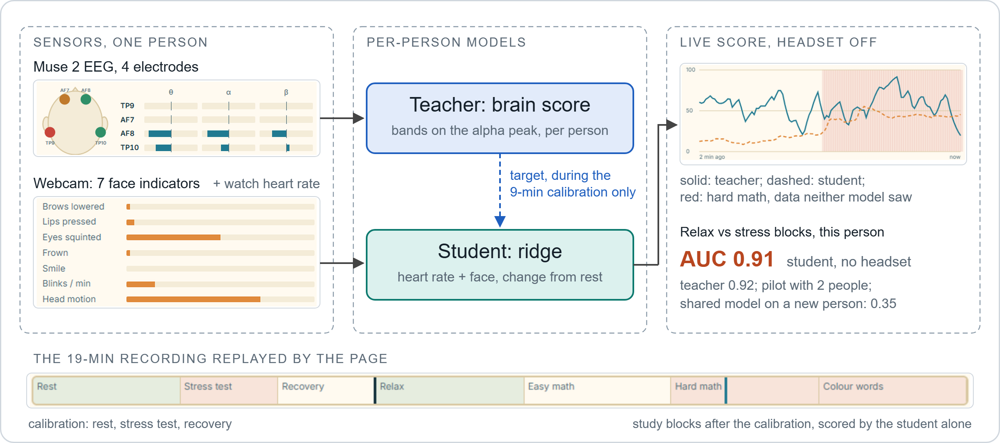

# Clutch live demo: an EEG headband calibrates a per-person stress model on heart rate and face

[Live demo](https://clementdumeril.github.io/clutch-demo/) · [Team repository](https://github.com/RishiL381/nuero-Cousins) (app, dataset, methods) · [Details](docs/details.md)



A static page that replays a real 19-minute recording of Clutch, a neurotech hackathon project (October 2026, team of three), second by second. A Muse 2 EEG "teacher" sets one person's stress scale during a 9-minute calibration, and a small "student" model learns to follow it from heart rate and webcam face indicators, so the headset can come off. On the blocks after the calibration the student separates relaxation from stress at AUC 0.91 for this person (pilot, 2 people).


*The live demo at 5x during the hard-math block, which neither model saw. Captured with [`tools/capture_frames.mjs`](tools/capture_frames.mjs) and [`tools/make_gif.py`](tools/make_gif.py).*

## Results (pilot, 2 people)

AUC for relaxation against hard math and colour words, on the study blocks after the calibration (0.5 = chance). Source: `results` in [`data.json`](data.json).

| Per person, calibrated on that person | Teacher (EEG) | Student (heart + face) | Student-teacher correlation |
| --- | --- | --- | --- |
| Person 1 (this recording) | 0.92 | 0.91 | 0.43 |
| Person 2 | 0.97 | 1.00 | 0.88 |

A single shared model tested on a person it never saw reaches 0.83 from EEG but only 0.35 from heart + face ([details](docs/details.md#shared-model-on-a-new-person)): without the per-person calibration, the headset-free signals do not carry over.

## What I built

39 of the 48 commits of the team repository: the Python app (Muse 2 streaming, EEG processing, calibration protocol and teacher, Garmin heart rate over Bluetooth, browser UI), the 7 MediaPipe face indicators, dataset export and the leave-one-participant-out evaluation, and this demo. Full split with Riley and Rishi in [`docs/details.md`](docs/details.md#what-i-built-in-full).

## Run it locally

```bash
python -m http.server 8002   # then open http://localhost:8002; the page fetches data.json, so file:// does not work
```

| File | Role |
| --- | --- |
| [`index.html`](index.html), [`demo.css`](demo.css), [`demo.js`](demo.js) | Page and replay: timeline, sensors, scores, chart, calibration report |
| [`data.json`](data.json) | Session P01_S02, 1116 s at 1 s per step, calibration report, aggregate results |
| [`pixel-sea.js`](pixel-sea.js) | Rishi's pixel-art sea, copied unchanged from the team repository |
| [`tools/`](tools) | Scripts that make the README GIF |

## Limitations

- Two participants, four sessions: the approach can work for one person once calibrated; it is not shown to generalise.
- For this recording the student uses the face indicators only: the watch gave a heart rate for 188 of the 410 calibration seconds, below the half the model requires. The page still labels it "heart + face".
- The recording is a team member's, shared with consent. No image or video is stored; the webcam gives 7 numbers per second, computed in the browser.
- A wellness prototype, not a medical device.

## Credits

Built in a weekend by Clément Dumeril, Riley and Rishi ([@RishiL381](https://github.com/RishiL381)), on [muse-lsl](https://github.com/alexandrebarachant/muse-lsl), [MediaPipe](https://ai.google.dev/edge/mediapipe), NumPy and scikit-learn.
