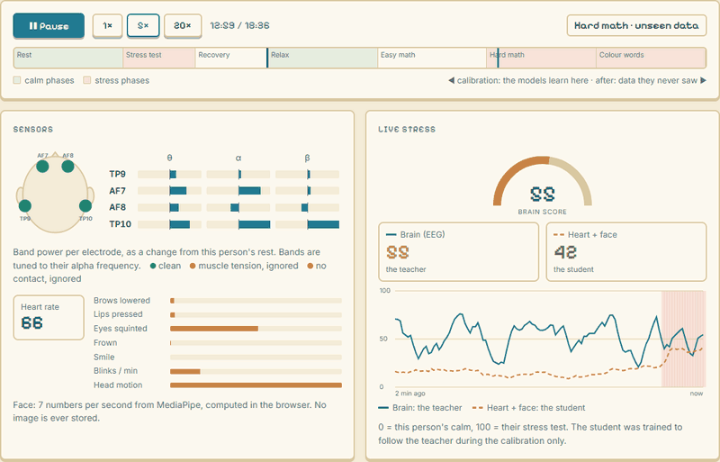
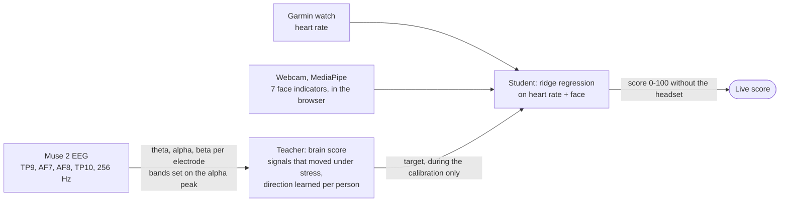

# Clutch live demo: an EEG headband calibrates a per-person stress model on heart rate and face

A static page that replays a real 19-minute recording of Clutch, a neurotech hackathon project (October 2026, team of three), second by second: a Muse 2 EEG "teacher" sets one person's stress scale, and a small "student" model learns to follow it from heart rate and webcam face indicators, so the headset can come off.

[Live demo](https://clementdumeril.github.io/clutch-demo/) · [Team repository](https://github.com/RishiL381/nuero-Cousins) (app, dataset, methods)



*The live demo at 5x, during the hard-math block that comes after the calibration, so neither model saw these seconds. Captured with [`tools/capture_frames.mjs`](tools/capture_frames.mjs) and [`tools/make_gif.py`](tools/make_gif.py).*

## How it works



1. Calibration, about 9 minutes: 3 min rest, a 2 min timed mental-math test, 2 min recovery, with two short questionnaires. EEG, watch and webcam record together.
2. Teacher: on each electrode, theta, alpha and beta power in bands placed on the person's individual alpha frequency. Windows with bad contact, head motion or muscle tension are dropped. Signals whose rest-to-stress effect size is large enough are kept, in whichever direction they moved for this person.
3. Student: a ridge regression from heart rate and the face indicators (each as a change from the person's rest) to the teacher's curve.
4. After the calibration, the student scores alone. In the recording shown, a study protocol follows: relaxation, easy math, hard math, colour words, 3 min each.

The page does not run the models: [`data.json`](data.json) holds the per-second scores that the team's code produced when this recording was replayed through it (`tools/build_demo.py` in the team repository). [`demo.js`](demo.js) draws them.

## Results (pilot, 2 people)

AUC for relaxation against hard math and colour words, on the study blocks after the calibration (0.5 = chance). Source: `results` in [`data.json`](data.json).

| Per person, calibrated on that person | Teacher (EEG) | Student (heart + face) | Student-teacher correlation |
| --- | --- | --- | --- |
| Person 1 (this recording) | 0.92 | 0.91 | 0.43 |
| Person 2 | 0.97 | 1.00 | 0.88 |

| One shared model, tested on the person it never saw (leave-one-participant-out, 4 sessions, 34 min labelled) | AUC |
| --- | --- |
| EEG features | 0.83 |
| Muscle (EMG) features | 0.69 |
| Heart rate | 0.36 |
| Face | 0.37 |
| Heart + face, no headset | 0.35 |

EEG features carry over to a new person; heart rate and face do not, and only become useful once calibrated on the person by the headset. With two people and one study session each, this is a pilot, not a validation.

## What I built

In the team repository I wrote 39 of the 48 commits:

- the Python app: Muse 2 streaming through muse-lsl, EEG processing (filters, band power on the individual alpha frequency, muscle and contact rejection), the calibration protocol and the teacher, the Garmin heart-rate connection over Bluetooth, and the browser UI;
- the 7 face indicators computed in the browser with MediaPipe (`frontend/face-sensor.js`);
- dataset recording and export, model training from the browser, and the leave-one-participant-out evaluation behind the second table;
- this demo: `tools/build_demo.py` there, and [`index.html`](index.html), [`demo.js`](demo.js), [`demo.css`](demo.css) here.

## Run it locally

```bash
python -m http.server 8002
```

Then open http://localhost:8002. Any static server works; the page fetches `data.json`, so opening the file directly does not.

| File | Role |
| --- | --- |
| [`index.html`](index.html), [`demo.css`](demo.css) | Page layout and text |
| [`demo.js`](demo.js) | Replay: timeline, sensors, scores, chart, calibration report, results |
| [`data.json`](data.json) | Session P01_S02, 1116 s at 1 s per step, plus the calibration report and the aggregate results |
| [`pixel-sea.js`](pixel-sea.js) | Rishi's pixel-art sea, copied unchanged from the team repository |
| [`tools/`](tools) | Scripts that make the README GIF |

## Limitations

- Two participants, four sessions. The numbers above show the approach can work for one person once calibrated; they do not show it generalises.
- For this recording the student uses the face indicators only: the watch gave a heart rate for 188 of the 410 calibration seconds, below the half the model requires. The page still labels it "heart + face".
- The recording is a team member's, shared with consent. No image or video is stored; the webcam gives 7 numbers per second, computed in the browser.
- A wellness prototype, not a medical device.

## Credits

Built in a weekend by Clément Dumeril, Riley and Rishi ([@RishiL381](https://github.com/RishiL381)).
Riley wrote the webcam face-tracker page, the personal model used as the student (`clutch/personal.py`), the calibration flip check, the study protocol and the `ml/` evaluation pipeline.
Rishi drew the pixel-art sea that the UI style follows, made the breathing break, and added the second participant's session.
Built on [muse-lsl](https://github.com/alexandrebarachant/muse-lsl), [MediaPipe](https://ai.google.dev/edge/mediapipe), NumPy and scikit-learn.
